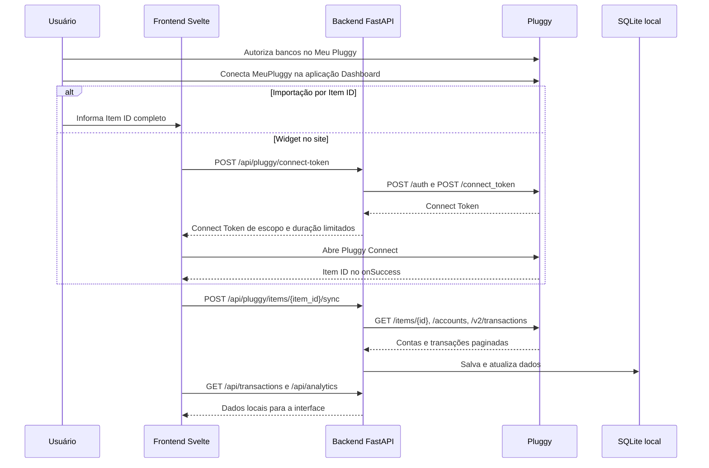

# Configuração do Meu Pluggy e fluxo de importação

Atualizado em 20/10/2026. O [guia oficial de uso pessoal](https://docs.pluggy.ai/en/docs/guides/meu-pluggy-personal-use) descreve o acesso gratuito para uso próprio, limitado a cinco conexões e sem uso comercial. Confira os termos atuais antes de ampliar o escopo.

## Configuração que usamos

1. Crie/acesse a conta em [Meu Pluggy](https://meu.pluggy.ai/) e autorize cada banco por lá. Essa é a origem dos dados bancários pessoais.
2. Entre no [Dashboard Pluggy](https://dashboard.pluggy.ai/) com a **mesma conta**. Crie uma aplicação se ainda não houver uma. Copie o Client ID e guarde o Client Secret quando for gerado; a Pluggy o mostra uma única vez e permite gerar outro se necessário.
3. Em **Customization → Connectors**, selecione o modo de conectores personalizados e habilite **MeuPluggy** em *Personal → Direct Connectors* (ID 200). Isso evita escolher por engano o conector direto do banco. Veja o [passo a passo do Dashboard](https://docs.pluggy.ai/en/docs/guides/dashboard-connectors).
4. Em **Applications → aplicação → Demo → Connect Account**, escolha **MeuPluggy** e autentique a conta do Meu Pluggy. O item aparece em **Connected Items**. Abra-o e copie o **Item ID completo**, em formato UUID. O item da aplicação precisa pertencer à mesma aplicação das credenciais usadas pelo backend. Não há listagem `GET /v2/items` para descobrir esses itens no acesso pessoal; guarde os IDs.
5. Coloque `PLUGGY_CLIENT_ID` e `PLUGGY_CLIENT_SECRET` no `.env` na raiz do projeto, conforme `.env.example`. `OPENAI_API_KEY` é opcional e só serve à classificação manual por IA. Não copie segredos para o frontend nem compartilhe o `.env` ou o Item ID completo em logs, issues ou capturas de tela.
6. Inicie backend e frontend como descrito no [README](../README.md). Na visão geral, cole o Item ID completo em **Meu Pluggy pessoal → Importar**. Depois use **Sincronizar** para novas consultas. O botão **Conectar banco** também abre o widget do Pluggy; ao concluir, o frontend recebe o Item ID e chama a mesma importação. São duas formas de obter o item, seguidas pelo mesmo fluxo de cópia local.

## O que cada componente faz

O backend troca Client ID/Secret por uma API Key em `POST /auth` e usa `X-API-KEY` para consultar dados. No fluxo do widget, o backend cria o Connect Token e entrega **somente esse token** ao navegador, como previsto na [documentação de autenticação do Pluggy Connect](https://v2.docs.pluggy.ai/en/docs/connect-widget/authentication). O token dura cerca de 30 minutos e tem permissões limitadas; ainda assim deve ser tratado como credencial temporária. A interface não recebe Client Secret nem API Key. O Item ID chega ao navegador quando o widget conclui, ou é digitado manualmente; ele é um identificador de item, não a credencial da API.

O backend só aceita na importação itens do conector MeuPluggy (ID 200), lê as contas e pagina as transações em `GET /v2/transactions` até acabar o cursor. A aplicação não define `dateFrom`/`dateTo` nesse pedido. Ela salva contas, saldos e transações no SQLite e aproveita a categoria que vem da Pluggy. A IA **não** é chamada durante o sync. O Meu Pluggy espelha atualizações geralmente a cada 24 horas; o app não força atualização do item na Pluggy. A duração do consentimento precisa ser acompanhada e pode exigir nova autorização. A [documentação oficial](https://docs.pluggy.ai/en/docs/guides/meu-pluggy-personal-use) descreve essas limitações.

## Diagnóstico seguro

- **422 Item ID inválido:** copie o UUID completo em *Connected Items*; um trecho curto não serve.
- **404 ao consultar item:** confira se o item pertence à aplicação cujas credenciais estão no `.env`.
- **422 conector diferente:** no Demo selecione **MeuPluggy**, não o banco nem Sandbox.
- **409 estado/consentimento:** revise a autorização no Meu Pluggy, aguarde a atualização do espelho e tente novamente.
- **502 em `transactions` com HTTP 410 da Pluggy:** esse caso já foi observado; a causa não foi confirmada. Confira o estado do item e se a aplicação/endpoint tem acesso às transações; registre a resposta da Pluggy com dados sensíveis removidos antes de concluir a causa. Não atribua o erro automaticamente ao Item ID quando a etapa `item` já passou.
- **429:** limite de requisições da Pluggy; aguarde antes de tentar de novo.

O fluxo é manual, sem webhook e sem fila. Uma sincronização repetida reaproveita o ID externo da transação dentro da mesma conta, mas a reconexão que cria novos itens exige reconciliação adicional no futuro. Consulte o [estado do projeto](PROJECT_STATUS.md).
